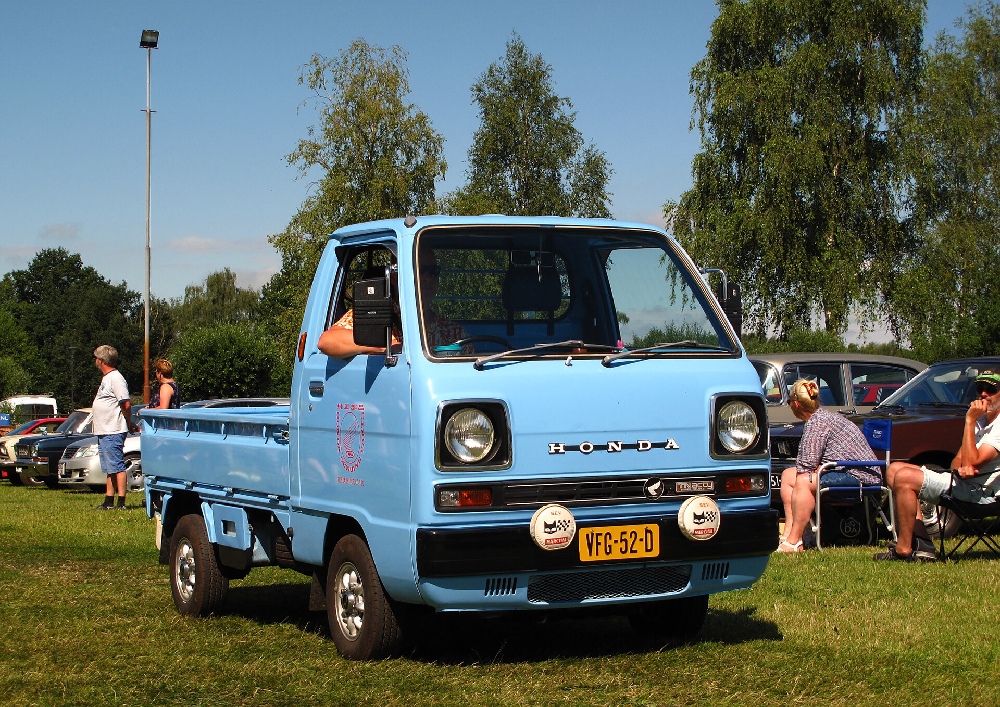
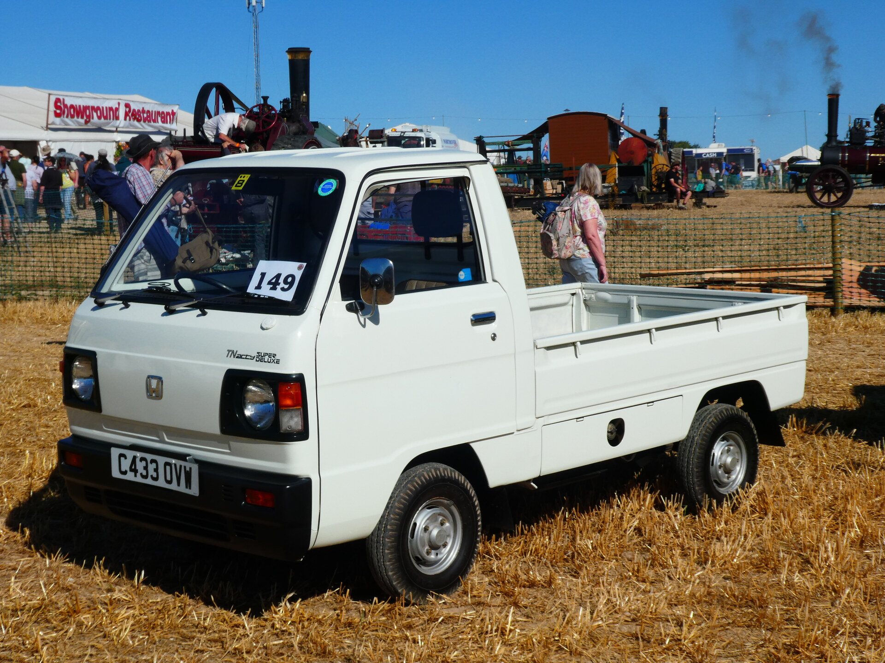
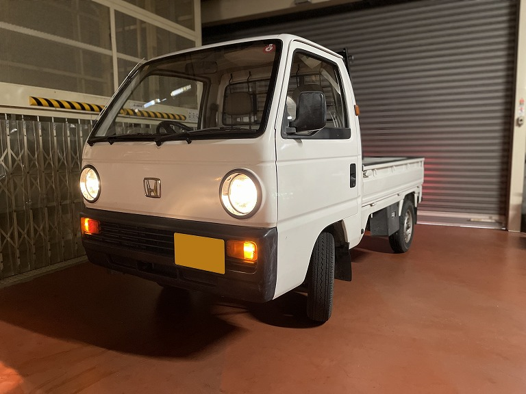
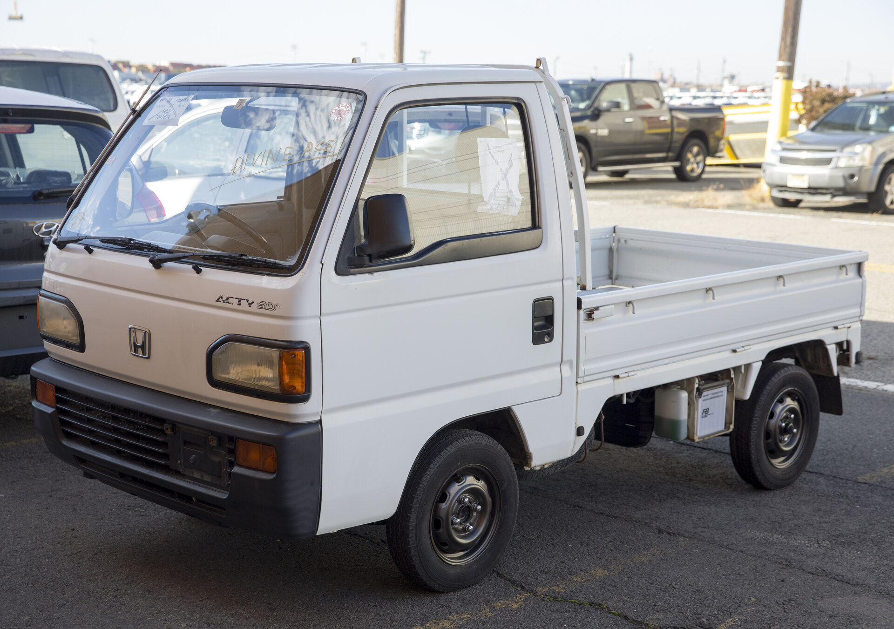
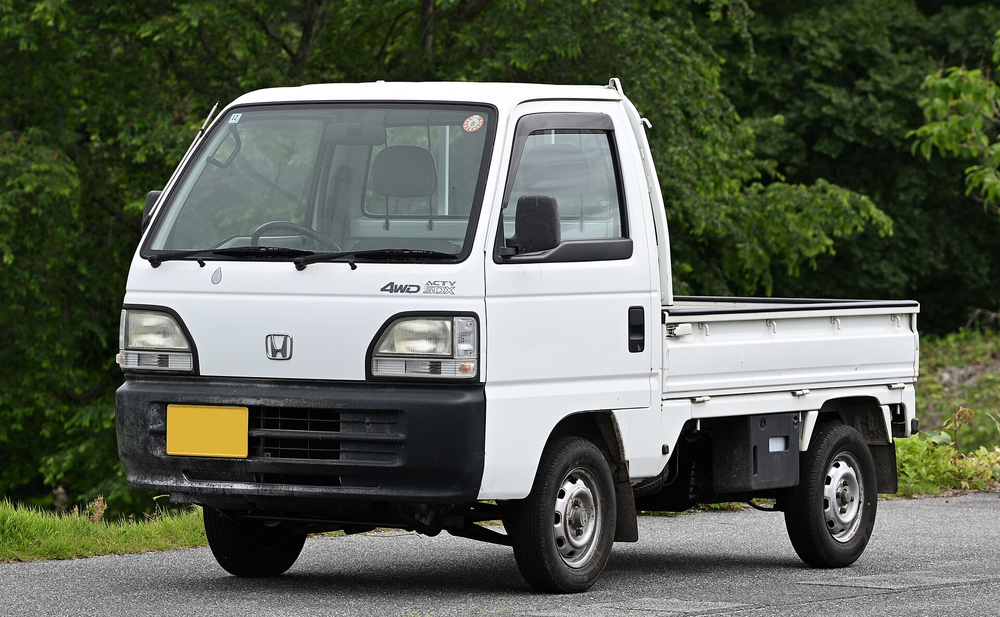
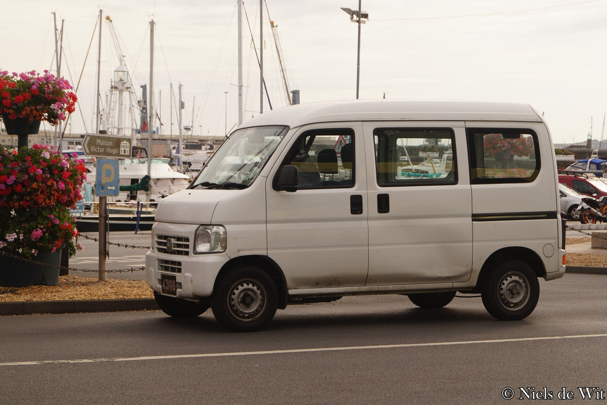
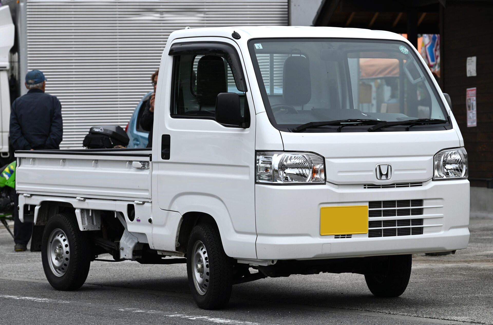

The Acty Truck used a mid-engine layout throughout production, with the engine mounted beneath the load bed.

# 1st Generation

## TA - Pre-facelift

* **Production:** 1977-1982
* **Engine:** EH 545cc SOHC I2, carburettor (28 PS)
* **Drivetrain:** RWD
* **Transmission:** 4-speed manual
* **Notes:** Updated in 1980 with improved corrosion protection. Engine access is through a hatch in the bed.

## TA / TC - Facelift

* **Production:** 1982-1988
* **Engine:** EH 545cc SOHC I2, carburettor (29-30 PS)
* **Drivetrain:** RWD (TA); selectable part-time 4WD (TC, from 1983)
* **Transmission:** 4/5-speed manual
* **Notes:** Big Cab trades some bed length for more cabin space. A 1985 update made front disc brakes standard and added optional air conditioning. 4WD-specific parts can be difficult to source.

# 2nd Generation

## HA1 / HA2 - 550cc, round-headlamp grades

* **Production:** 1988-1990
* **Engine:** E05A 547cc SOHC 12-valve I3, carburettor (34 PS)
* **Drivetrain:** RWD (HA1); Real Time 4WD (HA2)
* **Transmission:** 4/5-speed manual; 3-speed automatic on selected 2WD grades
* **Notes:** First three-cylinder Acty. STD, SDX and ATTACK trucks used the exposed round headlamps shown here; the better-equipped SDX-II instead had rectangular halogen lamps, despite sharing the same HA1 code. ATTACK adds ultra-low forward and reverse gears and a locking rear differential. The 550cc engine is noticeably slower than later 660cc trucks.

## HA3 / HA4 - 660cc, 1990 front

* **Production:** 1990-1994
* **Engine:** E07A 656cc SOHC 12-valve I3, carburettor (38 PS)
* **Drivetrain:** RWD (HA3); Real Time 4WD (HA4)
* **Transmission:** 4/5-speed manual; 3-speed automatic on selected 2WD grades
* **Notes:** The 660cc update lengthened the nose by 20mm, gave every truck halogen headlamps and fitted a larger black bumper. This first 660cc face retains separate amber front indicators.

## HA3 / HA4 / HA5 - 1994 facelift

* **Production:** 1994-1999
* **Engine:** E07A 656cc SOHC 12-valve I3, carburettor (38 PS); PGM-FI on SDX-Hi (44 PS, from 1996)
* **Drivetrain:** RWD (HA3); Real Time 4WD (HA4); tracked rear drive (HA5 Crawler)
* **Transmission:** 4/5-speed manual; 3-speed automatic on selected 2WD grades
* **Notes:** January 1994 brought larger, chamfered headlamp units and a reshaped bumper; the front indicators changed from amber to clear in 1996. The factory HA5 Acty Crawler added a second rear axle and removable tire-driven rubber tracks, and is a distinct chassis rather than an aftermarket six-wheel conversion. Town and ATTACK versions continued.

# 3rd Generation

## HA6 / HA7

* **Production:** 1999-2009
* **Engine:** E07Z 656cc SOHC 12-valve I3, PGM-FI (46 PS)
* **Drivetrain:** RWD (HA6); Real Time 4WD (HA7)
* **Transmission:** 5-speed manual
* **Notes:** Wider semi-cabover design with fuel injection and a standard driver airbag; ABS and air conditioning were optional. The long wheelbase improves road stability but gives a larger turning circle and cramped footwells. A December 2000 revision changed the front styling and extended the bed from 1,870mm to 1,940mm, so early and later HA6/HA7 trucks are visibly and dimensionally different. Check early trucks for sill and chassis corrosion.

# 4th Generation

## HA8 / HA9

* **Production:** 2009-2021
* **Engine:** E07Z 656cc SOHC 12-valve I3, PGM-FI (45 PS)
* **Drivetrain:** RWD (HA8); Real Time 4WD (HA9)
* **Transmission:** 5-speed manual
* **Notes:** Returned to a short-wheelbase cabover layout, improving manoeuvrability and foot room. Driver airbag was standard; ABS, passenger airbag and air conditioning varied by grade. Attack models add crawler gears and a locking rear differential. Production ended in April 2021.
