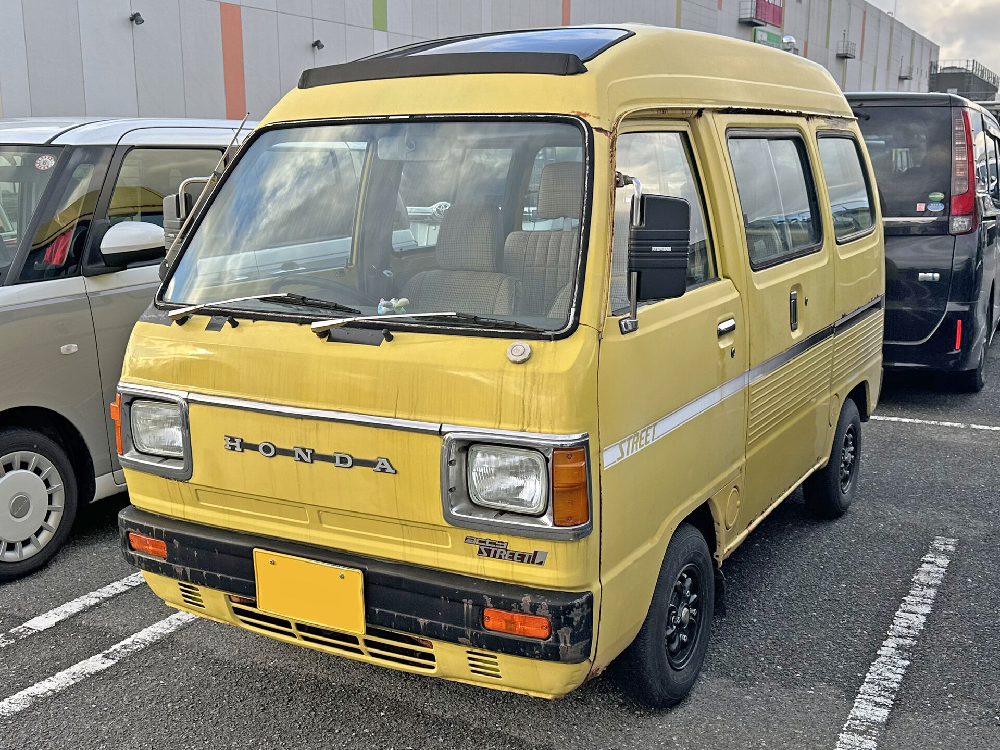
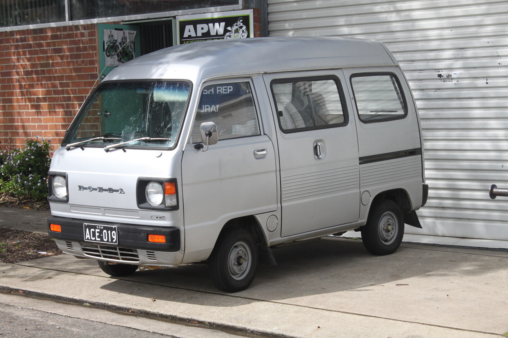
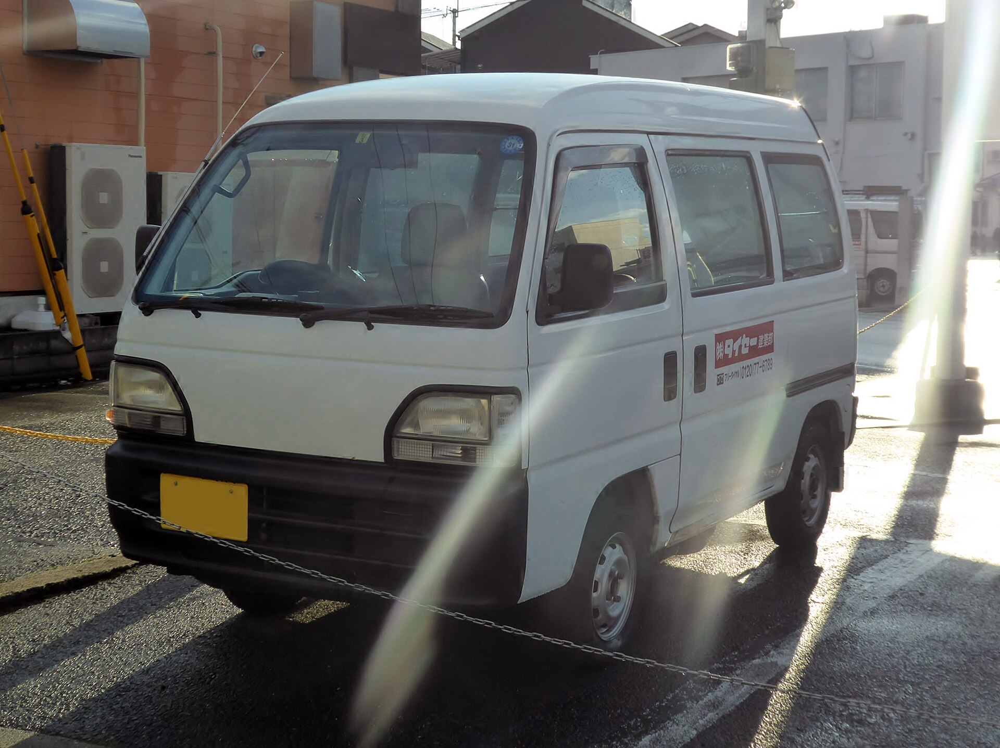
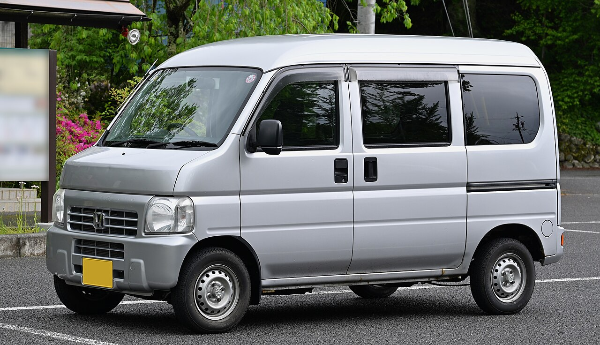

The Acty Van used a mid-engine layout throughout production, with the engine mounted beneath the cargo floor. Honda sold the passenger-focused Street alongside the first two generations, but it was a separate model with different trim and, on some versions, a different front treatment; Street photographs are therefore not used here as stand-ins for Acty Vans.

# 1st Generation

## VD - Pre-facelift

* **Production:** 1979-1982
* **Engine:** EH 545cc SOHC I2, carburettor (28 PS)
* **Drivetrain:** RWD
* **Transmission:** 4-speed manual
* **Notes:** Offered with standard or high roof. The better-equipped Acty Street joined the range in 1981.

## VD / VH - Facelift

* **Production:** 1982-1988
* **Engine:** EH 545cc SOHC I2, carburettor (29-30 PS)
* **Drivetrain:** RWD (VD); selectable part-time 4WD (VH, from 1983)
* **Transmission:** 4/5-speed manual
* **Notes:** Front disc brakes became standard and air conditioning optional in 1985. 4WD-specific parts can be difficult to source.

# 2nd Generation

## HH1 / HH2 - 550cc, round-headlamp grades

* **Production:** 1988-1990
* **Engine:** E05A 547cc SOHC 12-valve I3, carburettor (34 PS)
* **Drivetrain:** RWD (HH1); Real Time 4WD (HH2)
* **Transmission:** 4/5-speed manual; 3-speed automatic on selected 2WD grades
* **Notes:** High-roof-only cargo body with dual sliding doors. PRO-B, PRO-T, STD and SDX used the exposed round headlamps shown here; SDX-II alone received rectangular halogen lamps. PRO-B is a two-seat load carrier and the rare PRO-T uses one front and one rear seat in tandem. Street L/X shared the body shell but added passenger trim, wind-down sliding-door windows and, on X, twin sunroofs.

## HH3 / HH4 - 660cc

* **Production:** 1990-1999
* **Engine:** E07A 656cc SOHC 12-valve I3, carburettor (38 PS); PGM-FI on SDX-Hi (44 PS)
* **Drivetrain:** RWD (HH3); Real Time 4WD (HH4)
* **Transmission:** 4/5-speed manual; 3-speed automatic on selected 2WD grades
* **Notes:** The March 1990 update lengthened the nose by 20mm and gave all Acty Vans rectangular halogen lamps and a larger bumper. A January 1994 facelift introduced the larger chamfered lamps shown in the photograph; indicators changed from amber to clear in 1996. Power steering and air conditioning were available on some grades. Street L/G/EX and later V/Xi models were passenger derivatives, not Acty Van trim levels.

# 3rd Generation

## HH5 / HH6

* **Production:** 1999-2018
* **Engine:** E07Z 656cc SOHC 12-valve I3, PGM-FI (45-46 PS)
* **Drivetrain:** RWD (HH5); Real Time 4WD (HH6)
* **Transmission:** 5-speed manual
* **Notes:** Wider semi-cabover design with a long wheelbase, low cargo floor and standard driver airbag. ABS and a passenger airbag were optional; air conditioning became standard in 2001. PRO-A and PRO-B are two-seat cargo models, while SDX and TOWN have folding rear seats. Production ended in July 2018, with the N-VAN taking over Honda's kei van role.
