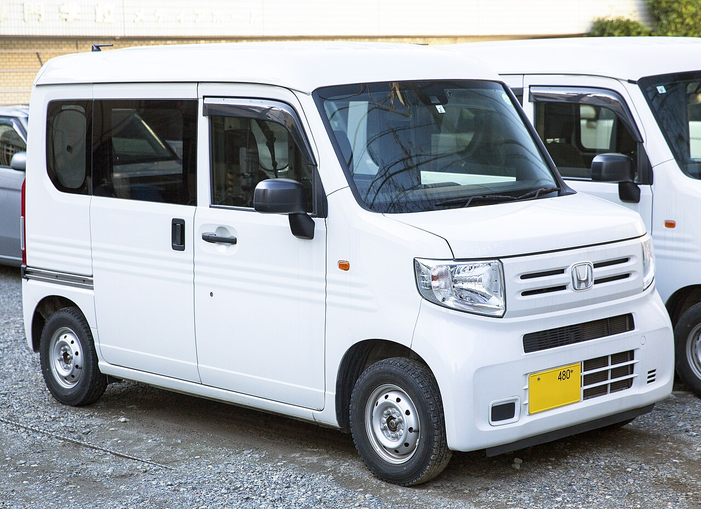
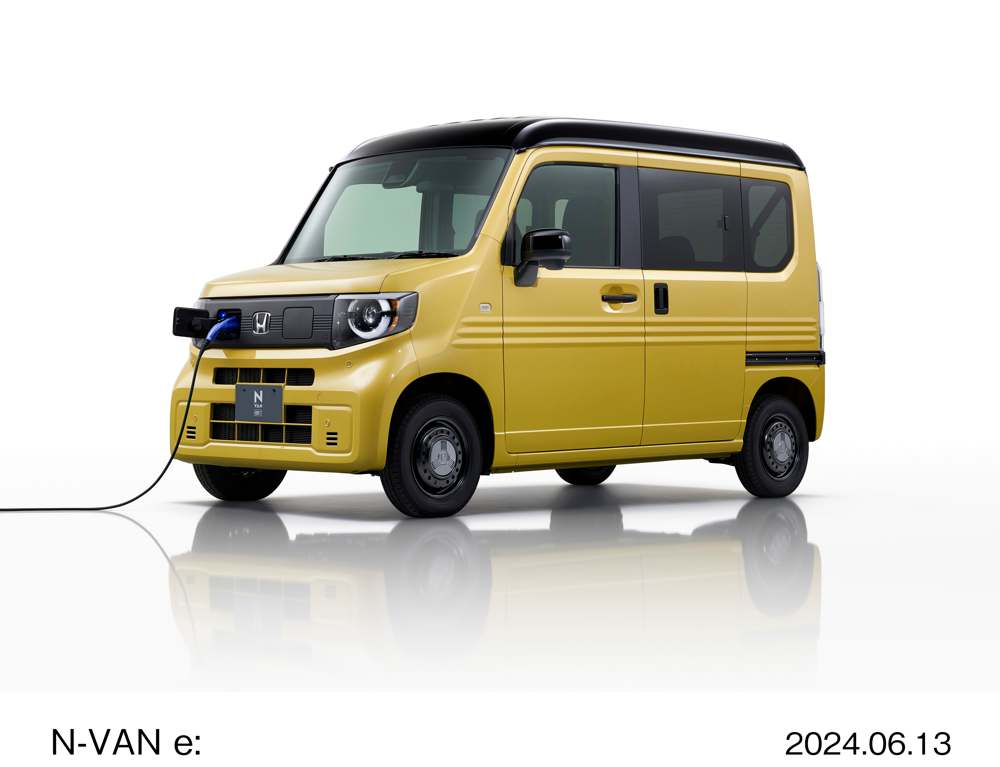

The N-VAN replaced the Acty Van as Honda's kei commercial van. Unlike the Acty's mid-engine layout, it uses a front-engine platform derived from the N-BOX.

# 1st Generation

## JJ1 / JJ2

* **Production:** 2018-present
* **Engine:** S07B 658cc DOHC 12-valve I3, PGM-FI (53 PS)
* **Drivetrain:** FWD (JJ1); 4WD (JJ2)
* **Transmission:** 6-speed manual
* **Notes:** Low cargo floor, folding passenger and rear seats, and a pillarless passenger-side opening. Air conditioning, front disc brakes, dual airbags, ABS and stability control are standard. Honda Sensing is fitted to most versions, but manuals omit some functions. From 2024, the manual was limited to G and FUN grades.

## JJ3 - N-VAN e:

* **Production:** 2024-present
* **Motor:** MCF7 AC synchronous motor (53 PS on e: G/L2/L4; 64 PS on e: FUN; 162 Nm)
* **Drivetrain:** FWD (JJ3)
* **Transmission:** Single-speed reduction gear
* **Notes:** Battery-electric derivative with a 245km WLTC range. It retains the pillarless passenger-side opening and flat cargo floor; e: G is a one-seater, e: L2 can be configured for one or two occupants, and e: L4/e: FUN seat four. AC charging at 6kW takes about 4.5 hours, while optional 50kW rapid charging reaches 80% in about 30 minutes.
