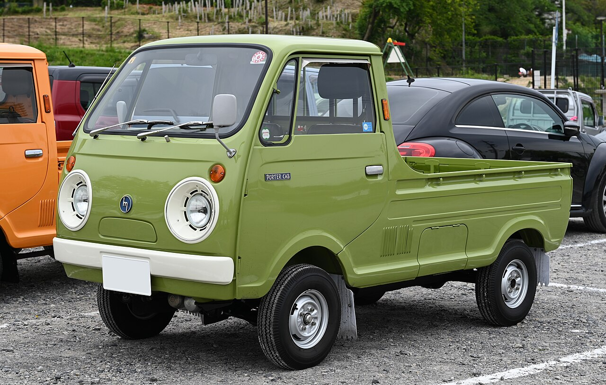
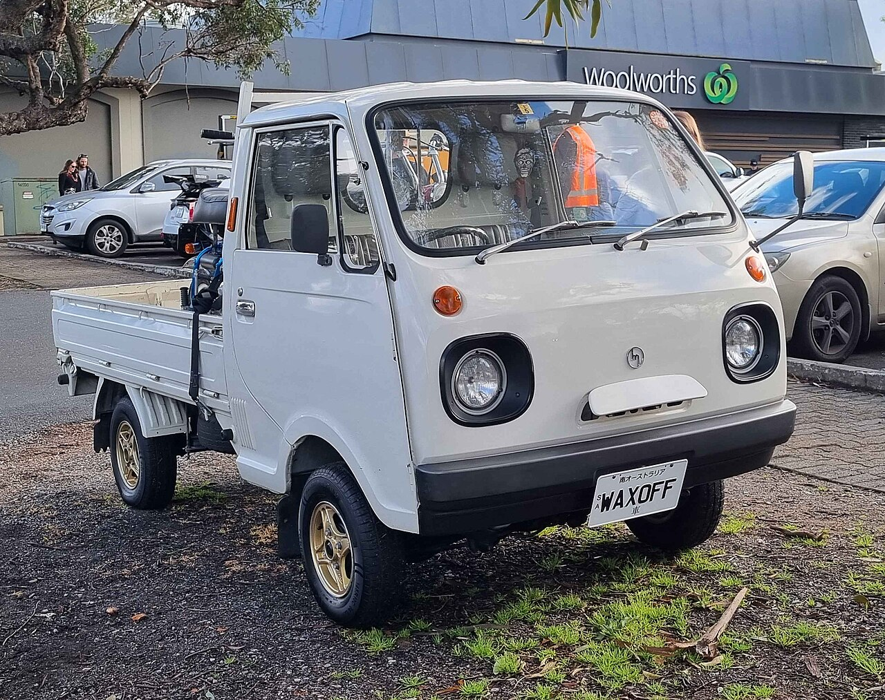
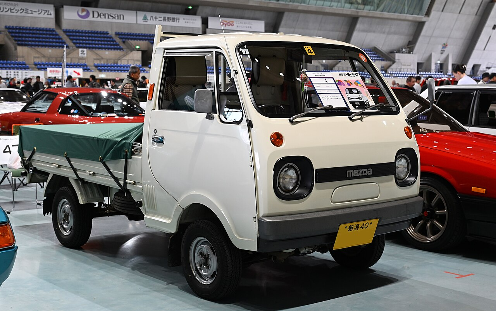

The Porter Cab was Mazda's independently developed cabover kei truck. It remained in a single generation throughout production, never offered four-wheel drive, and was replaced by the Suzuki-built Scrum in 1989.

# 1st Generation

## KECA53 / PC3A - 360cc

* **Production:** 1969-1977
* **Engine:** CC 359cc air-cooled two-stroke I2, carburettor (23 PS); AA 359cc water-cooled two-stroke I2, carburettor (29-30 PS, from 1973)
* **Drivetrain:** RWD
* **Transmission:** 4-speed manual
* **Notes:** The original air-cooled KECA53 gained wind-down door glass and front ventilation in 1970. Mazda replaced the CC engine with the more powerful water-cooled AA in 1973, then introduced the emissions-compliant PC3A in April 1976. The 1975 update accommodated larger registration plates and PC3A trucks were painted white; two-stroke models require dedicated two-stroke oil. KECB53 is sometimes quoted in listings but belongs neither to this Porter Cab sequence nor to the later 550cc trucks.

## PC4D - 550cc

* **Production:** 1977-1983
* **Engine:** 2G23 546cc SOHC I2, carburettor (29-31 PS)
* **Drivetrain:** RWD
* **Transmission:** 4-speed manual
* **Notes:** Enlarged for the 550cc kei regulations and renamed New Porter Cab. The engine was supplied by Mitsubishi.

## PC56T - Facelift

* **Production:** 1983-1989
* **Engine:** G23B 546cc SOHC I2, carburettor (31 PS)
* **Drivetrain:** RWD
* **Transmission:** 4-speed manual
* **Notes:** Facelifted again in 1985; air conditioning became optional in 1987. Model-specific parts are scarce.
