Mitsubishi-developed petrol Minicab Vans ran through 2014. Subsequent petrol/manual models are rebadged Suzuki Every vans, while Mitsubishi's U67V/U68V and U69V electric vans form a separate, Mitsubishi-developed branch. Estate, Bravo and Town Box were passenger-focused derivatives rather than interchangeable names for the cargo van.

# 3rd Generation

## L012PV - Minicab 5

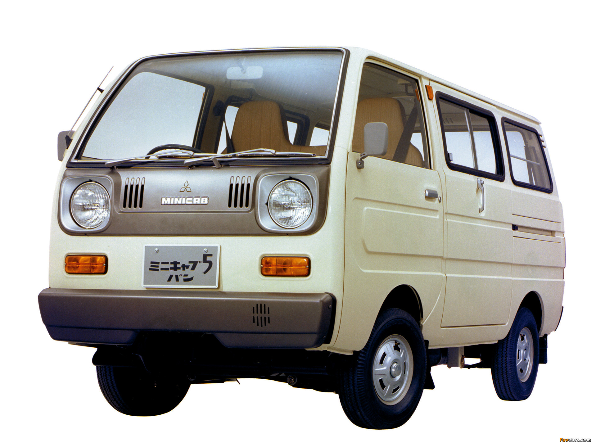

* **Production:** 1976-1977
* **Engine:** 2G22 471cc SOHC I2, carburettor (28 PS)
* **Drivetrain:** RWD
* **Transmission:** 4-speed manual
* **Notes:** Short-lived interim 500cc model; the rear side doors changed from hinged to sliding. Like other early interim kei models, it met the new length limit with extended bumpers while retaining the narrow body—the later Wide 55 shown below is visibly broader.

## L013PV / L015PV / L015GV - Wide 55

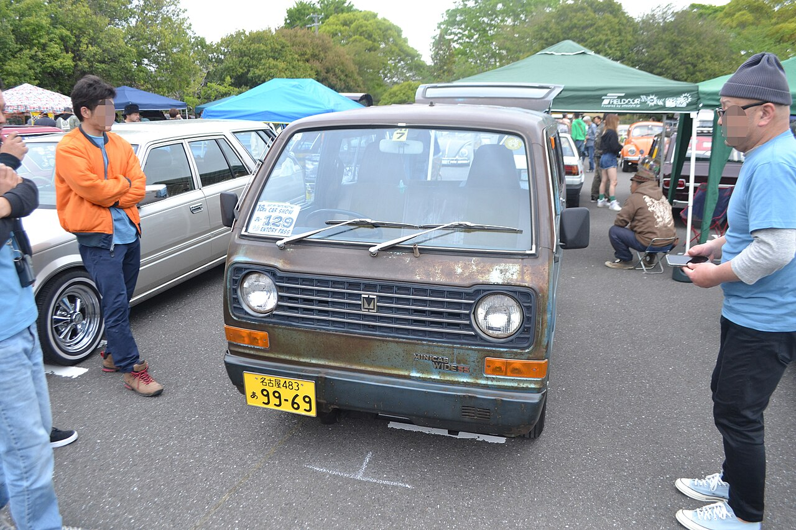

* **Production:** 1977-1984
* **Engine:** 2G23/G23B 546cc SOHC I2, carburettor (29-31 PS)
* **Drivetrain:** RWD (L013PV/L015PV); selectable part-time 4WD (L015GV, from 1982)
* **Transmission:** 4-speed manual
* **Notes:** The wider 550cc body replaced the interim Minicab 5. The better-equipped Estate passenger derivative joined in 1981; 4WD followed in 1982.

# 4th Generation

## U11V / U12V / U14V / U15V - 550cc

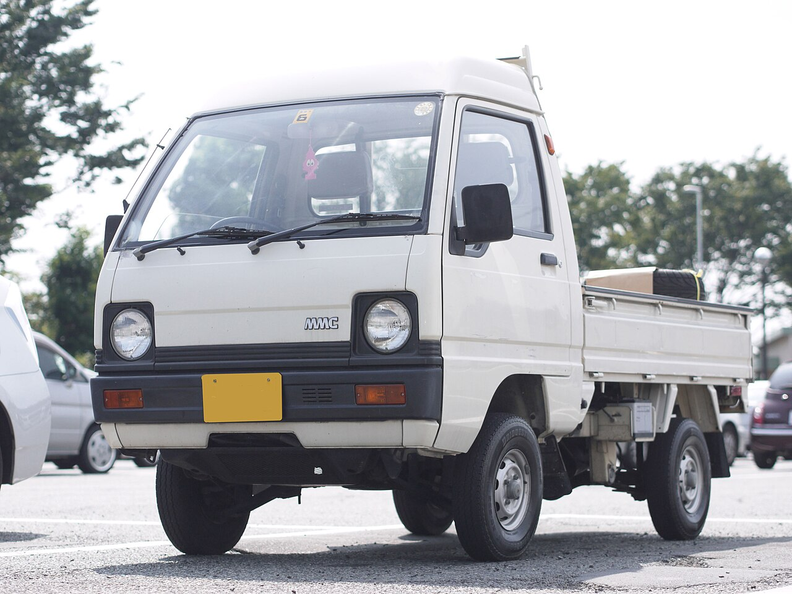

* **Production:** 1984-1990
* **Engine:** G23B 546cc SOHC I2, carburettor (31 PS); 3G81 548cc SOHC I3, carburettor (30-32 PS); supercharged (46 PS)
* **Drivetrain:** RWD (U11V/U14V); selectable part-time 4WD (U12V/U15V)
* **Transmission:** 4/5-speed manual
* **Notes:** High-roof and Super Aero Roof bodies were offered. Air conditioning was optional, 4WD versions had front disc brakes, and Estate was renamed Minicab Bravo in 1989.

## U18V / U19V - 660cc

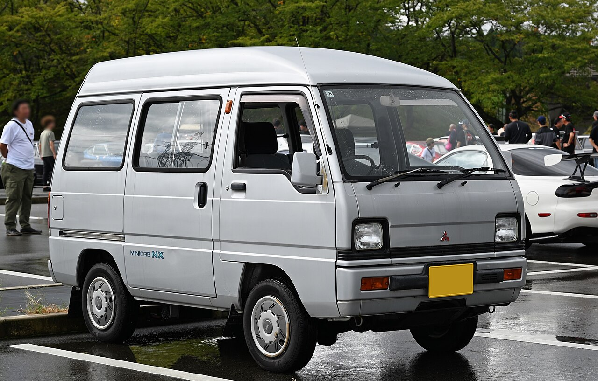

* **Production:** 1990-1991
* **Engine:** 3G83 657cc SOHC I3, carburettor (38 PS)
* **Drivetrain:** RWD (U18V); selectable part-time 4WD (U19V)
* **Transmission:** 4/5-speed manual
* **Notes:** Transitional 660cc update; 550cc supercharged vans continued alongside it.

# 5th Generation

## U41V / U42V

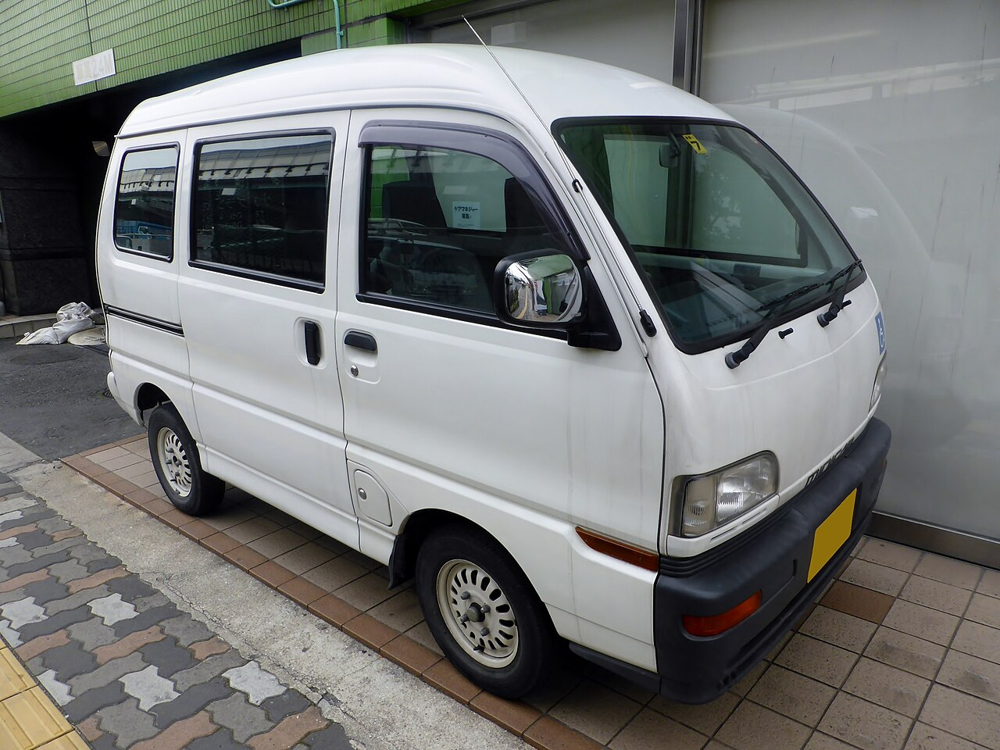

* **Production:** 1991-1999
* **Engine:** 3G83 657cc SOHC 12-valve I3, carburettor (42 PS); EFI (48 PS, from 1996)
* **Drivetrain:** RWD (U41V); selectable part-time 4WD (U42V)
* **Transmission:** 4/5-speed manual
* **Notes:** High-roof and two-seat cargo versions were offered. Front disc brakes were fitted to most models; air conditioning and power steering were available. Bravo became a separate passenger model.

# 6th Generation

## U61V / U62V

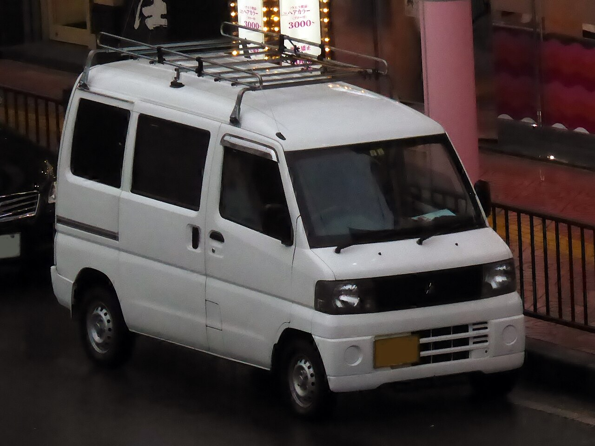

* **Production:** 1999-2014
* **Engine:** 3G83 657cc SOHC 12-valve I3, EFI (48 PS)
* **Drivetrain:** RWD (U61V); selectable part-time 4WD (U62V)
* **Transmission:** 5-speed manual
* **Notes:** Wider semi-cabover body with a long wheelbase. Dual airbags became standard in 2004; air conditioning and ABS varied by grade. Town Box was the passenger derivative.

# Battery-electric Branch

## U67V / U68V - Minicab-MiEV

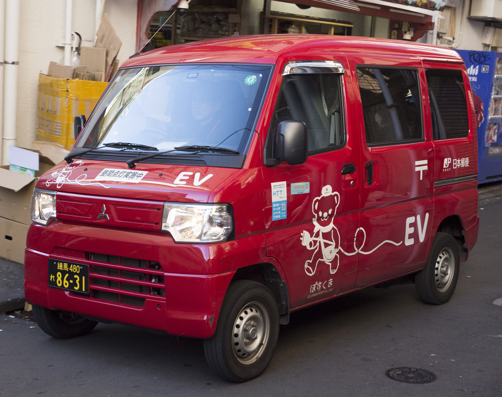

* **Production:** 2011-2023
* **Motor:** Y4F1 permanent-magnet synchronous motor (41 PS; 196 Nm)
* **Drivetrain:** RWD
* **Transmission:** Single-speed reduction gear
* **Notes:** Electric version of the sixth-generation Mitsubishi body, initially offered with 10.5kWh or 16kWh batteries. U67V denotes the 10.5kWh van and U68V the 16kWh version; the short-lived U68T Minicab-MiEV Truck was a separate pickup. Unlike the petrol Minicab, the electric van remained Mitsubishi-built after 2014. General sales resumed in November 2022 after a production pause.

## U69V - Minicab EV

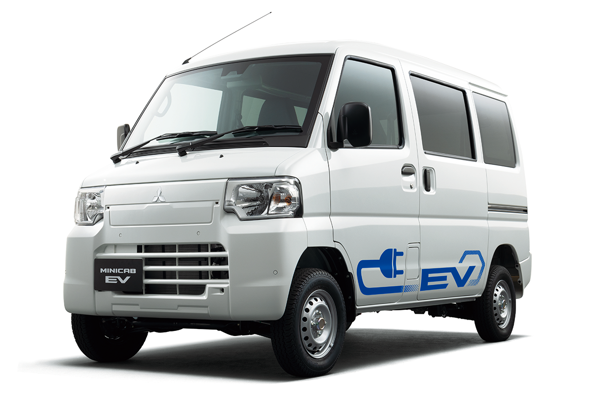

* **Production:** 2023-present
* **Motor:** YA1 permanent-magnet synchronous motor (42 PS; 195 Nm)
* **Drivetrain:** RWD
* **Transmission:** Single-speed reduction gear
* **Notes:** Heavily updated successor to the Minicab-MiEV, retaining the Mitsubishi body rather than adopting the Suzuki Every shell. A 20kWh battery provides a 180km WLTC range; two- and four-seat versions are offered.

# 7th Generation

## DS64V - Suzuki OEM

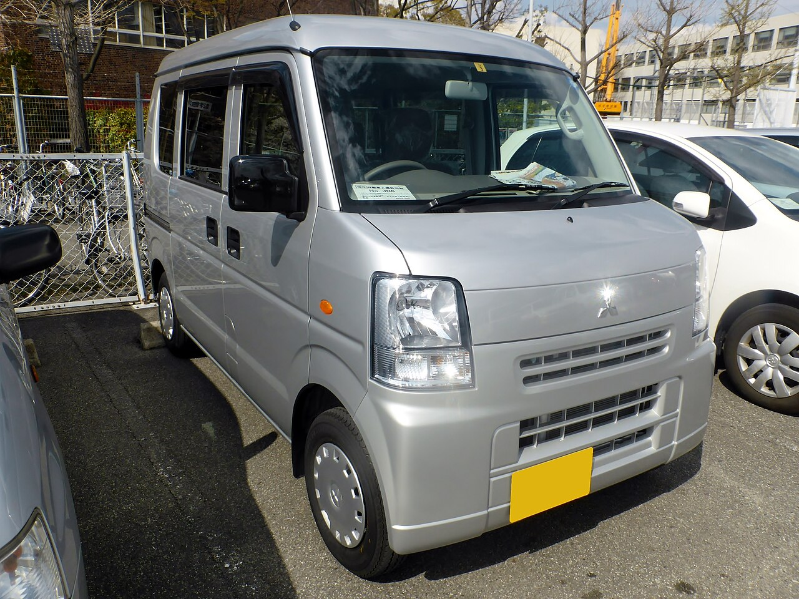

* **Production:** 2014-2015
* **Notes:** Rebadged eleventh-generation [Suzuki Every](suzuki_every.md). Mitsubishi omitted the standard-roof model and limited the five-speed manual to the M grade; badges and grade names account for the main differences.

# 8th Generation

## DS17V - Suzuki OEM

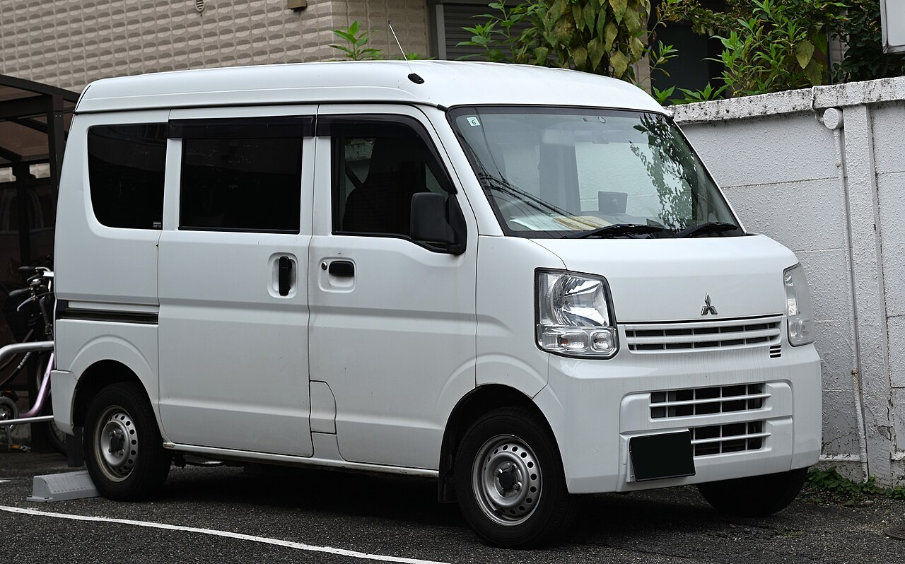

* **Production:** 2015-2026
* **Notes:** Rebadged twelfth-generation [Suzuki Every](suzuki_every.md). The Mitsubishi range used different grade names and a narrower colour and equipment selection; manuals were limited to entry grades.

## DS18V - Suzuki OEM

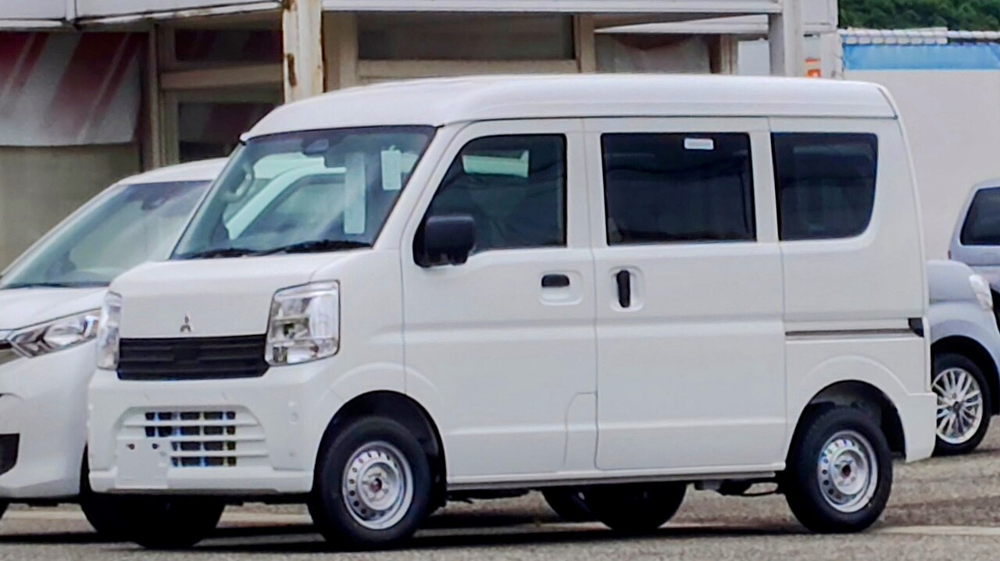

* **Production:** 2026-present
* **Notes:** Updated version of the twelfth-generation [Suzuki Every](suzuki_every.md). Differences are mainly Mitsubishi badges, grade names and equipment packaging; the five-speed manual is limited to the M grade.
