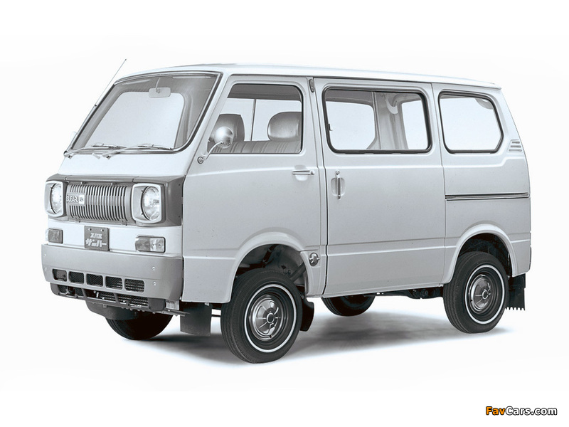
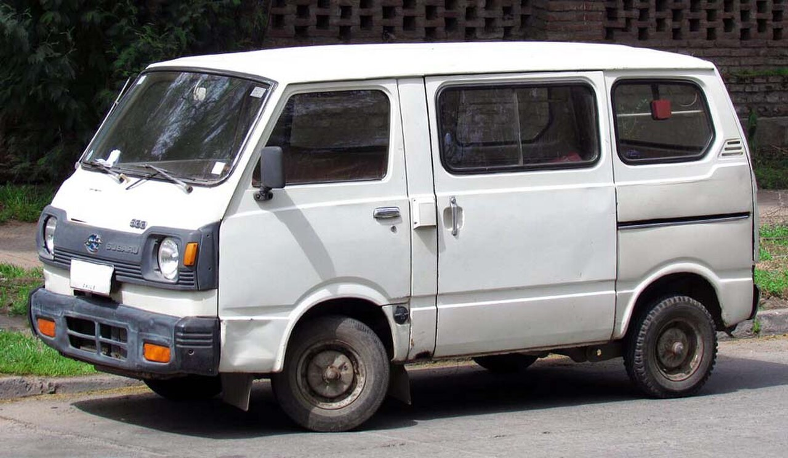
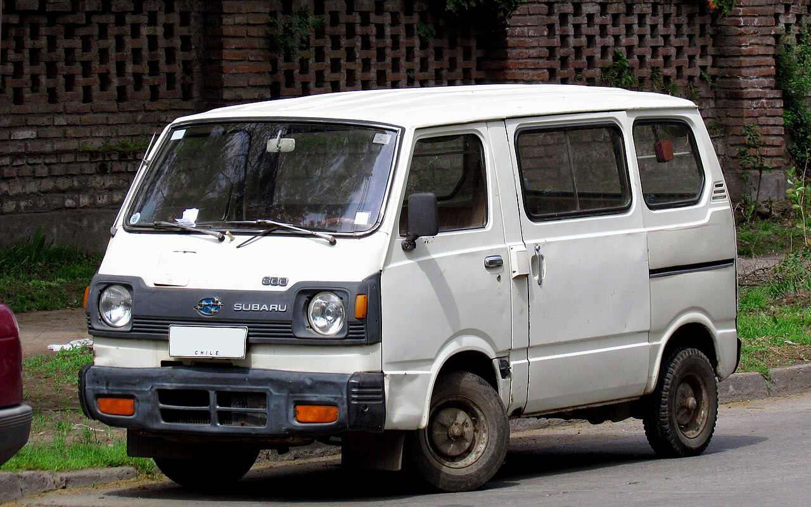
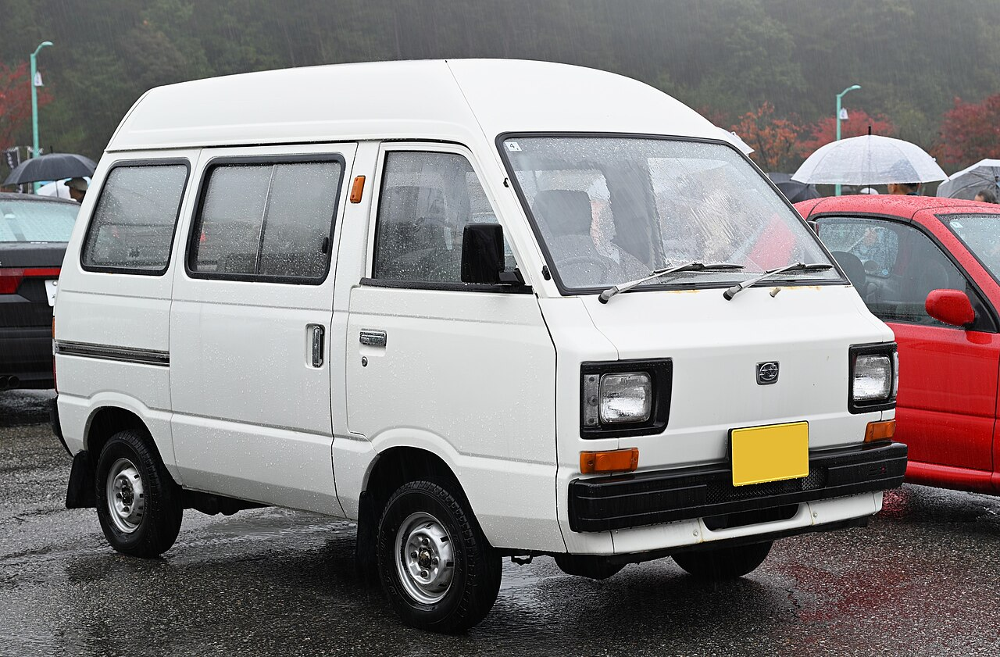
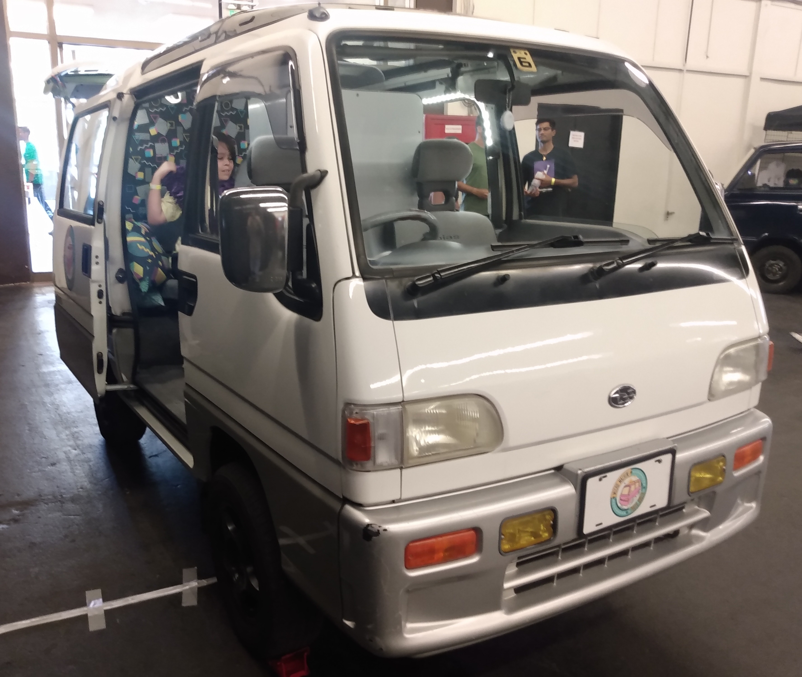
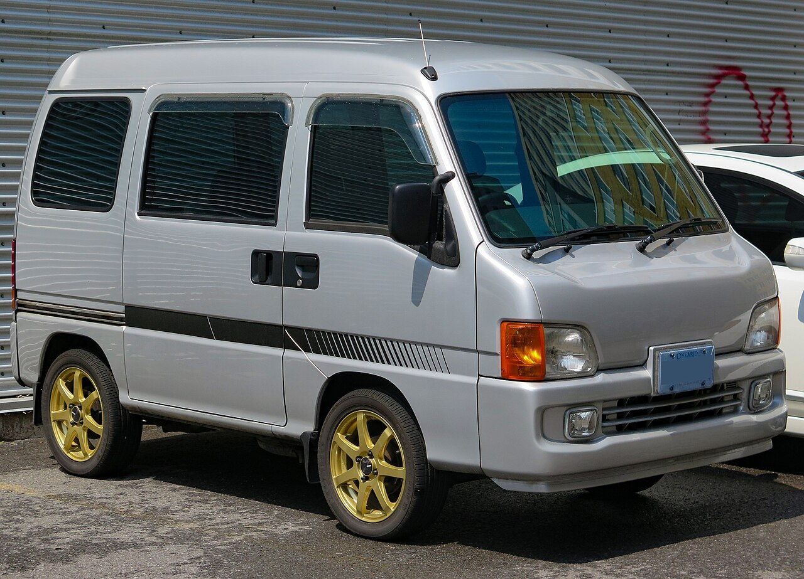
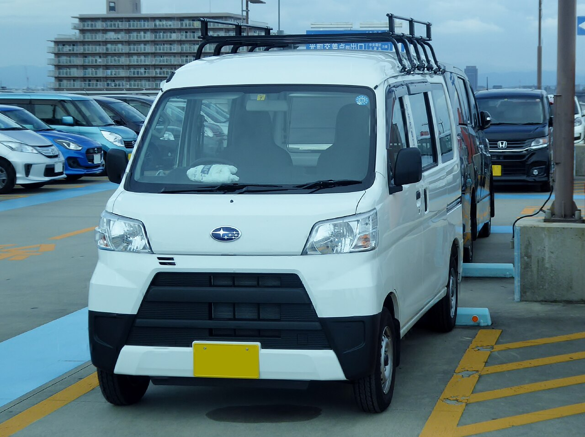
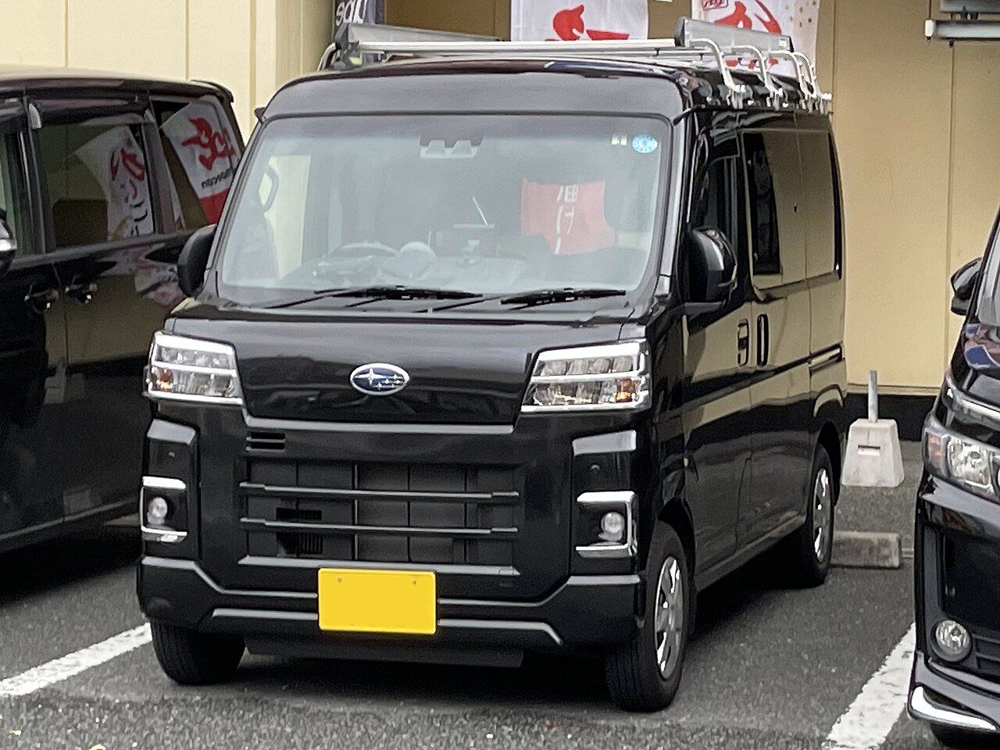

Subaru-developed Sambar Vans used a rear-engine layout and four-wheel independent suspension through 2012. Try and Dias began as passenger-focused grades of the commercial van, while the 1999-on Dias Wagon used separate TW-series passenger-car codes. Later Sambar Vans are rebadged Daihatsu Hijet Cargo vans.

# 3rd Generation

## K81 - 360cc

* **Production:** 1973-1976
* **Engine:** EK34 356cc two-stroke I2, carburettor (28 PS); EK21 358cc SOHC I2, carburettor (28 PS, from 1976)
* **Drivetrain:** RWD
* **Transmission:** 4-speed manual
* **Notes:** Known as the Gouriki Sambar. The four-stroke engine replaced the two-stroke in 1976.

## K85 - Sambar 5

* **Production:** 1976-1977
* **Engine:** EK22 490cc SOHC I2, carburettor (28 PS)
* **Drivetrain:** RWD
* **Transmission:** 4-speed manual
* **Notes:** Short-lived interim model with extended bumpers rather than a wider body.

## K87 / K88 - 550cc

* **Production:** 1977-1982
* **Engine:** EK23 544cc SOHC I2, carburettor (28 PS)
* **Drivetrain:** RWD (K87); selectable part-time 4WD (K88, from 1980)
* **Transmission:** 4-speed manual
* **Notes:** A high-roof model arrived in 1979, followed by the first factory four-wheel-drive kei van in 1980.

# 4th Generation

## KR1 / KR2 / KR5 / KR6

* **Production:** 1982-1990
* **Engine:** EK23 544cc SOHC I2, carburettor (28-34 PS)
* **Drivetrain:** RWD (KR1/KR5); part-time or full-time 4WD (KR2/KR6, depending on year and grade)
* **Transmission:** 4/5-speed manual
* **Notes:** The passenger-focused Sambar Try introduced a high roof and flat-folding interior. A 1987 facelift added 34 PS three-valve engines and ventilated front disc brakes on later 4WD models; air conditioning was optional.

# 5th Generation

## KV3 / KV4 - Van and Dias

* **Production:** 1990-1999
* **Engine:** EN07 658cc SOHC I4, carburettor or EFI (40-46 PS); supercharged EFI (55 PS)
* **Drivetrain:** RWD (KV3); part-time or full-time 4WD (KV4, depending on grade)
* **Transmission:** 5-speed manual
* **Notes:** First four-cylinder Sambar Van. The photograph shows a high-grade Dias, but it retains the KV commercial-van chassis and body. Twin-sunroof versions were available, while the Classic introduced in 1993 had a deliberately retro round-headlamp nose and should not be mistaken for the standard front. Air conditioning and power steering were available.

# 6th Generation

## TV1 / TV2

* **Production:** 1999-2012
* **Engine:** EN07 658cc SOHC I4, EFI (46-48 PS); supercharged EFI (58 PS)
* **Drivetrain:** RWD (TV1); selectable part-time 4WD (TV2)
* **Transmission:** 5-speed manual
* **Notes:** Last Subaru-developed Sambar Van, retaining the rear engine and four-wheel independent suspension. Driver airbag was standard; air conditioning and ABS varied by grade. The similarly shaped Dias Wagon is TW1/TW2 and is a distinct passenger model rather than another name for the TV-series van.

### Sambar EV

Subaru added a low-volume factory electric van in December 2000. It used two-wheel drive and a fixed reduction gear, with planned production of only 35 vehicles per year. This was a factory TV-series derivative, not one of the later aftermarket EV conversions sometimes seen for sale.

# 7th Generation

## S321B / S331B - Daihatsu OEM

* **Production:** 2012-2022
* **Notes:** Rebadged tenth-generation [Daihatsu Hijet Van](daihatsu_hijet_van.md). Differences are mainly Subaru badges and grade names; the Hijet Deck Van was sold as the Sambar Open Deck (S321Q/S331Q).

# 8th Generation

## S700B / S710B - Daihatsu OEM

* **Production:** 2022-present
* **Notes:** Rebadged eleventh-generation [Daihatsu Hijet Van](daihatsu_hijet_van.md). Differences are limited to Subaru badges, grade names and equipment packaging.
